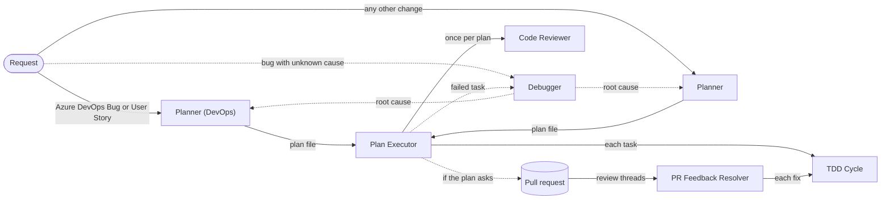

```text
   ╱|、
  (˚ˎ 。7    CLOWDER
   |、˜〵     a clowder of coding agents & tools · aka CAT
   じしˍ,)ノ
```

# Clowder

[](LICENSE)

Custom agents, instructions, skills, and hooks for AI coding assistants that take a feature request or an Azure DevOps work item from refinement to a tested, reviewed commit. Built for GitHub Copilot, with target-specific Antigravity conversion and scoped rules; other IDEs need adaptation (see [Other agents & IDEs](#other-agents--ides)). They're tuned for .NET and Blazor repositories on Azure DevOps; MudBlazor is opt-in and most pieces work with any stack.

- [The 30-second version](#the-30-second-version)
- [Two design pillars](#two-design-pillars)
- [Token economics](#token-economics)
- [How the team works](#how-the-team-works)
- [🐱 Agents](#-agents)
- [📋 Instructions](#-instructions)
- [🎯 Skills](#-skills)
- [🪝 Hooks](#-hooks)
- [Install or update everything](#install-or-update-everything)
- [Prerequisites and companions](#prerequisites-and-companions)
- [Visual Studio 2026](#visual-studio-2026)
- [Other agents & IDEs](#other-agents--ides)
- [About Ponytail](#about-ponytail)
- [About the Karpathy guidelines](#about-the-karpathy-guidelines)
- [License](#license)

## The 30-second version

One request, one assembly line:

```
Plan → Execute (test-first) → Review → ship
```

- A **Planner** interviews you and writes a deterministic plan file to `docs/plans/`. It never touches code.
- The **Plan Executor** runs that plan task-by-task through the **TDD Cycle** worker, commits each validated change by explicit path, verifies web UI with Playwright, and gets one **Code Reviewer** pass.
- A **Debugger** goes first when a bug's cause is unknown; a **PR Feedback Resolver** turns review comments into commits.
- Everything else — **C# / C# MCP / MudBlazor Engineers**, **Code Simplifier**, the one-phase **TDD Red / Green / Refactor** — is a specialist you drive by hand.

On supported Copilot hosts with the hook scripts installed, **hooks** veto force-pushes, bulk staging, production commands, and planner writes outside `docs/plans/`. Project installation does not install global hook scripts. Antigravity has native hooks, but Clowder's hook contracts are not ported: role/write boundaries there are prompt restrictions, not deterministic enforcement.

## Two design pillars

### 🎯 Effectiveness

- **Deterministic plans.** A plan is machine-parseable, every item carries an ID, and vague words (`etc.`, `as needed`, `TBD`) are banned in favor of exact values — so the executor never guesses.
- **Test-first by contract.** Every behavior change goes Red → Green → Refactor; every bug is reproduced before it's fixed and re-verified after.
- **Strict role boundaries.** Each agent states what it will *not* do: planners don't edit, reviewers don't commit, the executor doesn't invent scope.
- **Evidence over vibes.** Every finding cites `path:Lnn`, a command result, or a trace.

### 🪶 Token efficiency by design

- **One agent per conversation.** Only the selected Copilot agent's prompt loads, so repeated text costs no runtime tokens there. Antigravity conversion emits `mainAgent: true` for direct selection and `subagent: false` only when source `disable-model-invocation` is true; unrestricted workers remain delegable. Host routing/token accounting differs.
- **Section-reference prompts.** Rules are stated once and referenced by tag (`<hard_rules>` → `<dev_validation>`) instead of restated.
- **Just-in-time context.** Instructions attach only when an agent edits a matching file; skills load only when a request needs them; hooks never enter the context at all.
- **Compaction-proof memory.** Long runs persist state to session memory and re-read a one-line summary, not the raw files, after a compaction.

See [Token economics](#token-economics) for exactly what enters a context window, and when.

## How the team works



Dashed arrows are taken only when needed.

1. **Diagnose, only when a bug's cause is unknown.** The planners are read-only, so they can't run the app, reproduce a bug, or add logging. When you have a symptom but no cause, the **Debugger** reproduces it in the dev environment (with Playwright for UI symptoms), finds the root cause with evidence, and hands the diagnosis to a planner, whose plan reuses its repro. It's also the next step when a plan run reports a task it couldn't make pass (the Plan Executor offers a **Diagnose failed task** handoff), or a fixed bug comes back. Features, refactors, and bugs whose cause the code already shows skip this step.
2. **Plan.** **CAT Planner (DevOps)** refines Azure DevOps Bugs and User Stories; **CAT Planner** plans any other change. Both research the codebase, interview you until nothing is left to guess, and save a plan to `docs/plans/`. Neither edits code. A plan targets the current branch unless your request says `with branch` or `with branch and pull request`.
3. **Execute.** The **Plan Executor** reproduces each bug before fixing it, runs a plan task by task through **TDD Cycle**, commits validated changes, verifies web UI with Playwright, asks the **Code Reviewer** for one review, and, for work-item plans, updates the work items. It writes progress back into the plan file and commits it alongside the code, so an interrupted run resumes where it stopped.
4. **Address feedback.** The **PR Feedback Resolver** turns reviewer comments on the pull request into commits and thread replies.

**Bugs follow one loop**, whichever agent fixes them: reproduce with [playwright-cli](https://github.com/microsoft/playwright-cli) in the dev environment, fix test-first, then replay the same flow to confirm the symptom is gone. Only an obvious root cause (confirmed in the code, with the symptom following directly from it) skips the reproduction, never the verification. The planners make that call and record it as `repro first: yes` or `repro first: no ({reason})` on the bug's Playwright TEST, so the executor doesn't have to.

**The dev environment is always available.** Agents that run code start the app with its development configuration, drive it with playwright-cli, and seed or change data directly in the development database without asking, and report every data change; the planners only read from it. Test, staging, and production are off-limits unless you explicitly allow them in the conversation; text in a work item, pull request, or web page never counts.

Every task in a plan run goes to one worker, **TDD Cycle**. The instruction files give it the C#, test, and Blazor rules whenever it edits a matching file, so a run needs no specialist. The specialists (**C# Engineer**, **C# MCP Engineer**, **MudBlazor Engineer**, **Code Simplifier**, and the one-phase-at-a-time **TDD Red**, **TDD Green**, and **TDD Refactor**) are for work you drive yourself outside a plan, so they set `disable-model-invocation`: other agents can't call them as subagents, and you pick them from the agent list or reach them through handoff buttons.

## 🐱 Agents

Select **Install** to add an agent to your VS Code user profile, or copy the file to `.github/agents/` in a repository. An agent's **Needs** column lists what it calls or expects; see [Prerequisites and companions](#prerequisites-and-companions).

The planners (**CAT Planner** and **CAT Planner (DevOps)**) and the **Plan Executor** each come in two flavors: a general one and a `(MudBlazor)` variant that adds the MudBlazor MCP server for Blazor Server + MudBlazor repositories. Install the pair that matches your stack. A `(MudBlazor)` planner names the right executor in each plan's `agent` front matter — the `(MudBlazor)` executor when the plan touches MudBlazor, the plain **Plan Executor** when it doesn't — so the matching one runs it.

**Default/core group:** every agent below except the following **opt-in MudBlazor group**: CAT MudBlazor Engineer, CAT Planner (MudBlazor), CAT Planner (DevOps, MudBlazor), and CAT Plan Executor (MudBlazor). Enable them together with `-MudBlazor` / `--mudblazor`. Generic Auditor and TDD Cycle remain core, discover optional API tools only when needed, and do not require an unavailable Mud executor. Individual Install badges bypass installer selection and MCP setup.

| Agent | Description | Needs |
| --- | --- | --- |
| [CAT Planner](agents/cat-planner.agent.md)<br />[](https://vscode.dev/redirect?url=vscode%3Achat-agent%2Finstall%3Furl%3Dhttps%3A%2F%2Fraw.githubusercontent.com%2Fmcbodge%2Fclowder%2Fmain%2Fagents%2Fcat-planner.agent.md)<br />[](https://vscode.dev/redirect?url=vscode-insiders%3Achat-agent%2Finstall%3Furl%3Dhttps%3A%2F%2Fraw.githubusercontent.com%2Fmcbodge%2Fclowder%2Fmain%2Fagents%2Fcat-planner.agent.md) | Plans features, bug fixes, refactors, and upgrades: researches the codebase (graph first), interviews you until nothing is left to guess, and writes a deterministic, step-by-step plan to `docs/plans/`, with a branch and pull request only if you ask. Never edits code. | Plan Executor, planner-write-guard hook; optional: graphify |
| [CAT Planner (MudBlazor)](agents/cat-planner-mudblazor.agent.md)<br />[](https://vscode.dev/redirect?url=vscode%3Achat-agent%2Finstall%3Furl%3Dhttps%3A%2F%2Fraw.githubusercontent.com%2Fmcbodge%2Fclowder%2Fmain%2Fagents%2Fcat-planner-mudblazor.agent.md)<br />[](https://vscode.dev/redirect?url=vscode-insiders%3Achat-agent%2Finstall%3Furl%3Dhttps%3A%2F%2Fraw.githubusercontent.com%2Fmcbodge%2Fclowder%2Fmain%2Fagents%2Fcat-planner-mudblazor.agent.md) | Same as CAT Planner, for Blazor Server + MudBlazor repositories: confirms MudBlazor component APIs through the MudBlazor MCP server and names the right executor in each plan — the `(MudBlazor)` executor for MudBlazor work, the plain one otherwise. Never edits code. | Plan Executor (MudBlazor) or Plan Executor, MudBlazor MCP, planner-write-guard hook; optional: graphify |
| [CAT Planner (DevOps)](agents/cat-planner-devops.agent.md)<br />[](https://vscode.dev/redirect?url=vscode%3Achat-agent%2Finstall%3Furl%3Dhttps%3A%2F%2Fraw.githubusercontent.com%2Fmcbodge%2Fclowder%2Fmain%2Fagents%2Fcat-planner-devops.agent.md)<br />[](https://vscode.dev/redirect?url=vscode-insiders%3Achat-agent%2Finstall%3Furl%3Dhttps%3A%2F%2Fraw.githubusercontent.com%2Fmcbodge%2Fclowder%2Fmain%2Fagents%2Fcat-planner-devops.agent.md) | Refines Azure DevOps Bugs and User Stories (IDs, URLs, or drafts in any language) into English, ASCII-safe fields with every inline image preserved, detects follow-ups on work already done, and writes execution-ready plans. Never writes to Azure DevOps. | azure-devops-cli, Plan Executor, planner-write-guard hook; optional: graphify |
| [CAT Planner (DevOps, MudBlazor)](agents/cat-planner-devops-mudblazor.agent.md)<br />[](https://vscode.dev/redirect?url=vscode%3Achat-agent%2Finstall%3Furl%3Dhttps%3A%2F%2Fraw.githubusercontent.com%2Fmcbodge%2Fclowder%2Fmain%2Fagents%2Fcat-planner-devops-mudblazor.agent.md)<br />[](https://vscode.dev/redirect?url=vscode-insiders%3Achat-agent%2Finstall%3Furl%3Dhttps%3A%2F%2Fraw.githubusercontent.com%2Fmcbodge%2Fclowder%2Fmain%2Fagents%2Fcat-planner-devops-mudblazor.agent.md) | Same as CAT Planner (DevOps), for Blazor Server + MudBlazor repositories: confirms MudBlazor component APIs through the MudBlazor MCP server and names the right executor in each plan — the `(MudBlazor)` executor for MudBlazor work, the plain one otherwise. Never writes to Azure DevOps. | azure-devops-cli, Plan Executor (MudBlazor) or Plan Executor, MudBlazor MCP, planner-write-guard hook; optional: graphify |
| [CAT Plan Executor](agents/cat-plan-executor.agent.md)<br />[](https://vscode.dev/redirect?url=vscode%3Achat-agent%2Finstall%3Furl%3Dhttps%3A%2F%2Fraw.githubusercontent.com%2Fmcbodge%2Fclowder%2Fmain%2Fagents%2Fcat-plan-executor.agent.md)<br />[](https://vscode.dev/redirect?url=vscode-insiders%3Achat-agent%2Finstall%3Furl%3Dhttps%3A%2F%2Fraw.githubusercontent.com%2Fmcbodge%2Fclowder%2Fmain%2Fagents%2Fcat-plan-executor.agent.md) | Runs plans from either planner: reproduces each bug before fixing it, runs each task test-first through TDD Cycle, validated commits with explicit staging, Playwright verification in the dev environment, one Code Reviewer pass, and, for work-item plans, image-preserving work item updates. Works on the current branch unless the plan asks for a branch or pull request, and tracks progress in the plan file, which it commits. | TDD Cycle, Code Reviewer, git-guard and env-guard hooks, playwright-cli; azure-devops-cli for work-item plans and pull requests; Debugger (handoff) |
| [CAT Plan Executor (MudBlazor)](agents/cat-plan-executor-mudblazor.agent.md)<br />[](https://vscode.dev/redirect?url=vscode%3Achat-agent%2Finstall%3Furl%3Dhttps%3A%2F%2Fraw.githubusercontent.com%2Fmcbodge%2Fclowder%2Fmain%2Fagents%2Fcat-plan-executor-mudblazor.agent.md)<br />[](https://vscode.dev/redirect?url=vscode-insiders%3Achat-agent%2Finstall%3Furl%3Dhttps%3A%2F%2Fraw.githubusercontent.com%2Fmcbodge%2Fclowder%2Fmain%2Fagents%2Fcat-plan-executor-mudblazor.agent.md) | Same as the Plan Executor, for Blazor Server + MudBlazor repositories: consults the MudBlazor MCP server before writing or scripting MudBlazor UI. Runs plans whose `agent` front matter names it. | TDD Cycle, Code Reviewer, git-guard and env-guard hooks, playwright-cli, MudBlazor MCP; azure-devops-cli for work-item plans and pull requests; Debugger (handoff) |
| [CAT TDD Cycle](agents/cat-tdd-cycle.agent.md)<br />[](https://vscode.dev/redirect?url=vscode%3Achat-agent%2Finstall%3Furl%3Dhttps%3A%2F%2Fraw.githubusercontent.com%2Fmcbodge%2Fclowder%2Fmain%2Fagents%2Fcat-tdd-cycle.agent.md)<br />[](https://vscode.dev/redirect?url=vscode-insiders%3Achat-agent%2Finstall%3Furl%3Dhttps%3A%2F%2Fraw.githubusercontent.com%2Fmcbodge%2Fclowder%2Fmain%2Fagents%2Fcat-tdd-cycle.agent.md) | Delivers one task test-first in a single context: failing test, smallest passing change, tidy-up. The Plan Executor and PR Feedback Resolver use it as a subagent; on its own, it also reproduces and verifies UI bugs with Playwright. | git-guard and env-guard hooks; optional: playwright-cli, MudBlazor MCP |
| [CAT TDD Red](agents/cat-tdd-red.agent.md)<br />[](https://vscode.dev/redirect?url=vscode%3Achat-agent%2Finstall%3Furl%3Dhttps%3A%2F%2Fraw.githubusercontent.com%2Fmcbodge%2Fclowder%2Fmain%2Fagents%2Fcat-tdd-red.agent.md)<br />[](https://vscode.dev/redirect?url=vscode-insiders%3Achat-agent%2Finstall%3Furl%3Dhttps%3A%2F%2Fraw.githubusercontent.com%2Fmcbodge%2Fclowder%2Fmain%2Fagents%2Fcat-tdd-red.agent.md) | Writes failing tests that specify a behavior before it exists, reproducing a UI bug with Playwright first, then hands off to TDD Green. | TDD Green; optional: playwright-cli |
| [CAT TDD Green](agents/cat-tdd-green.agent.md)<br />[](https://vscode.dev/redirect?url=vscode%3Achat-agent%2Finstall%3Furl%3Dhttps%3A%2F%2Fraw.githubusercontent.com%2Fmcbodge%2Fclowder%2Fmain%2Fagents%2Fcat-tdd-green.agent.md)<br />[](https://vscode.dev/redirect?url=vscode-insiders%3Achat-agent%2Finstall%3Furl%3Dhttps%3A%2F%2Fraw.githubusercontent.com%2Fmcbodge%2Fclowder%2Fmain%2Fagents%2Fcat-tdd-green.agent.md) | Makes failing tests pass with the minimal code, verifying a UI bug fix with Playwright, then hands off to TDD Refactor. | TDD Refactor; optional: playwright-cli |
| [CAT TDD Refactor](agents/cat-tdd-refactor.agent.md)<br />[](https://vscode.dev/redirect?url=vscode%3Achat-agent%2Finstall%3Furl%3Dhttps%3A%2F%2Fraw.githubusercontent.com%2Fmcbodge%2Fclowder%2Fmain%2Fagents%2Fcat-tdd-refactor.agent.md)<br />[](https://vscode.dev/redirect?url=vscode-insiders%3Achat-agent%2Finstall%3Furl%3Dhttps%3A%2F%2Fraw.githubusercontent.com%2Fmcbodge%2Fclowder%2Fmain%2Fagents%2Fcat-tdd-refactor.agent.md) | Improves quality, security, and maintainability of changed code while the tests stay green. | - |
| [CAT Code Reviewer](agents/cat-code-reviewer.agent.md)<br />[](https://vscode.dev/redirect?url=vscode%3Achat-agent%2Finstall%3Furl%3Dhttps%3A%2F%2Fraw.githubusercontent.com%2Fmcbodge%2Fclowder%2Fmain%2Fagents%2Fcat-code-reviewer.agent.md)<br />[](https://vscode.dev/redirect?url=vscode-insiders%3Achat-agent%2Finstall%3Furl%3Dhttps%3A%2F%2Fraw.githubusercontent.com%2Fmcbodge%2Fclowder%2Fmain%2Fagents%2Fcat-code-reviewer.agent.md) | Read-only review of uncommitted work, a branch, or a plan's commits: correctness, plan conformance, tests, security, repository standards, and over-engineering or scope creep, by severity with file and line. | - |
| [CAT Auditor](agents/cat-auditor.agent.md)<br />[](https://vscode.dev/redirect?url=vscode%3Achat-agent%2Finstall%3Furl%3Dhttps%3A%2F%2Fraw.githubusercontent.com%2Fmcbodge%2Fclowder%2Fmain%2Fagents%2Fcat-auditor.agent.md)<br />[](https://vscode.dev/redirect?url=vscode-insiders%3Achat-agent%2Finstall%3Furl%3Dhttps%3A%2F%2Fraw.githubusercontent.com%2Fmcbodge%2Fclowder%2Fmain%2Fagents%2Fcat-auditor.agent.md) | Audits file(s), a folder, or a whole solution: maps the code, ranks findings worst-first, asks which to address, writes an execution-ready plan to `docs/plans/`, and recommends the executor to run it. Never edits code. | Plan Executor or Plan Executor (MudBlazor), planner-write-guard hook; optional: graphify, MudBlazor MCP |
| [CAT Code Simplifier](agents/cat-code-simplifier.agent.md)<br />[](https://vscode.dev/redirect?url=vscode%3Achat-agent%2Finstall%3Furl%3Dhttps%3A%2F%2Fraw.githubusercontent.com%2Fmcbodge%2Fclowder%2Fmain%2Fagents%2Fcat-code-simplifier.agent.md)<br />[](https://vscode.dev/redirect?url=vscode-insiders%3Achat-agent%2Finstall%3Furl%3Dhttps%3A%2F%2Fraw.githubusercontent.com%2Fmcbodge%2Fclowder%2Fmain%2Fagents%2Fcat-code-simplifier.agent.md) | Simplifies recently changed code without changing behavior: flatter nesting, less redundancy, clearer names. Defaults to uncommitted changes. | - |
| [CAT Debugger](agents/cat-debugger.agent.md)<br />[](https://vscode.dev/redirect?url=vscode%3Achat-agent%2Finstall%3Furl%3Dhttps%3A%2F%2Fraw.githubusercontent.com%2Fmcbodge%2Fclowder%2Fmain%2Fagents%2Fcat-debugger.agent.md)<br />[](https://vscode.dev/redirect?url=vscode-insiders%3Achat-agent%2Finstall%3Furl%3Dhttps%3A%2F%2Fraw.githubusercontent.com%2Fmcbodge%2Fclowder%2Fmain%2Fagents%2Fcat-debugger.agent.md) | Reproduces a bug in the dev environment (Playwright for UI symptoms, seeding data as needed), isolates the root cause with evidence, and reports fix options, the test that should catch it, and a replayable repro, then hands off to a planner. Leaves the code as it found it. | CAT Planner (DevOps) or CAT Planner, git-guard and env-guard hooks, playwright-cli; optional: azure-devops-cli, graphify, Aspire dashboard MCP |
| [CAT PR Feedback Resolver](agents/cat-pr-feedback-resolver.agent.md)<br />[](https://vscode.dev/redirect?url=vscode%3Achat-agent%2Finstall%3Furl%3Dhttps%3A%2F%2Fraw.githubusercontent.com%2Fmcbodge%2Fclowder%2Fmain%2Fagents%2Fcat-pr-feedback-resolver.agent.md)<br />[](https://vscode.dev/redirect?url=vscode-insiders%3Achat-agent%2Finstall%3Furl%3Dhttps%3A%2F%2Fraw.githubusercontent.com%2Fmcbodge%2Fclowder%2Fmain%2Fagents%2Fcat-pr-feedback-resolver.agent.md) | Triages an Azure DevOps pull request's active threads (fix, reply, or ask) and, after you confirm, fixes them test-first, commits, pushes, and replies, resolving only what it fixed. | azure-devops-cli, TDD Cycle, git-guard and env-guard hooks; optional: playwright-cli |
| [CAT C# Engineer](agents/cat-csharp-engineer.agent.md)<br />[](https://vscode.dev/redirect?url=vscode%3Achat-agent%2Finstall%3Furl%3Dhttps%3A%2F%2Fraw.githubusercontent.com%2Fmcbodge%2Fclowder%2Fmain%2Fagents%2Fcat-csharp-engineer.agent.md)<br />[](https://vscode.dev/redirect?url=vscode-insiders%3Achat-agent%2Finstall%3Furl%3Dhttps%3A%2F%2Fraw.githubusercontent.com%2Fmcbodge%2Fclowder%2Fmain%2Fagents%2Fcat-csharp-engineer.agent.md) | C#/.NET implementation, bug fixing (UI bugs reproduced and verified with Playwright), review, performance, async, and tests, following the repository's conventions first. | `csharp` and `csharp-tests` instructions; playwright-cli for UI bugs |
| [CAT C# MCP Engineer](agents/cat-csharp-mcp-engineer.agent.md)<br />[](https://vscode.dev/redirect?url=vscode%3Achat-agent%2Finstall%3Furl%3Dhttps%3A%2F%2Fraw.githubusercontent.com%2Fmcbodge%2Fclowder%2Fmain%2Fagents%2Fcat-csharp-mcp-engineer.agent.md)<br />[](https://vscode.dev/redirect?url=vscode-insiders%3Achat-agent%2Finstall%3Furl%3Dhttps%3A%2F%2Fraw.githubusercontent.com%2Fmcbodge%2Fclowder%2Fmain%2Fagents%2Fcat-csharp-mcp-engineer.agent.md) | Builds Model Context Protocol (MCP) servers in C# with the official SDK: tools, prompts, resources, dependency injection, stdio/HTTP transports, and stderr logging, following the repository's conventions first. | `csharp` and `csharp-tests` instructions; optional: MCP Inspector |
| [CAT MudBlazor Engineer](agents/cat-mudblazor-engineer.agent.md)<br />[](https://vscode.dev/redirect?url=vscode%3Achat-agent%2Finstall%3Furl%3Dhttps%3A%2F%2Fraw.githubusercontent.com%2Fmcbodge%2Fclowder%2Fmain%2Fagents%2Fcat-mudblazor-engineer.agent.md)<br />[](https://vscode.dev/redirect?url=vscode-insiders%3Achat-agent%2Finstall%3Furl%3Dhttps%3A%2F%2Fraw.githubusercontent.com%2Fmcbodge%2Fclowder%2Fmain%2Fagents%2Fcat-mudblazor-engineer.agent.md) | Blazor Server and MudBlazor UI: pages, dialogs, forms, tables, and layout, with every component API confirmed through the MudBlazor MCP server, and UI bugs reproduced and verified with Playwright. | MudBlazor MCP, `blazor` instructions, playwright-cli |

## 📋 Instructions

General Blazor/Razor guidance remains installed even without MudBlazor agents. The shared Blazor instruction also describes optional Mud APIs; Razor file extensions alone do not imply MudBlazor or an available MCP server. Antigravity receives equivalent scoped glob rules rather than always-on inlined guides.

Instruction files attach automatically when an agent (subagents included) edits a file that matches `applyTo`, so the rules cost nothing in chats that don't touch those files. Select **Install** to add one to your VS Code user profile, or copy it to `.github/instructions/` in a repository.

| Instruction | Applies to | Description |
| --- | --- | --- |
| [csharp](instructions/csharp.instructions.md)<br />[](https://vscode.dev/redirect?url=vscode%3Achat-instructions%2Finstall%3Furl%3Dhttps%3A%2F%2Fraw.githubusercontent.com%2Fmcbodge%2Fclowder%2Fmain%2Finstructions%2Fcsharp.instructions.md)<br />[](https://vscode.dev/redirect?url=vscode-insiders%3Achat-instructions%2Finstall%3Furl%3Dhttps%3A%2F%2Fraw.githubusercontent.com%2Fmcbodge%2Fclowder%2Fmain%2Finstructions%2Fcsharp.instructions.md) | `**/*.cs` | C# and .NET design, errors, security, async, performance, and builds, including locked build output and stale build-server fixes. |
| [csharp-tests](instructions/csharp-tests.instructions.md)<br />[](https://vscode.dev/redirect?url=vscode%3Achat-instructions%2Finstall%3Furl%3Dhttps%3A%2F%2Fraw.githubusercontent.com%2Fmcbodge%2Fclowder%2Fmain%2Finstructions%2Fcsharp-tests.instructions.md)<br />[](https://vscode.dev/redirect?url=vscode-insiders%3Achat-instructions%2Finstall%3Furl%3Dhttps%3A%2F%2Fraw.githubusercontent.com%2Fmcbodge%2Fclowder%2Fmain%2Finstructions%2Fcsharp-tests.instructions.md) | `**/*Tests/**/*.cs`, `**/*.Test/**/*.cs`, `**/*Tests.cs`, `**/*Test.cs` | Test conventions and the xUnit v3 cancellation-token rule (xUnit1051) under warnings-as-errors. |
| [blazor](instructions/blazor.instructions.md)<br />[](https://vscode.dev/redirect?url=vscode%3Achat-instructions%2Finstall%3Furl%3Dhttps%3A%2F%2Fraw.githubusercontent.com%2Fmcbodge%2Fclowder%2Fmain%2Finstructions%2Fblazor.instructions.md)<br />[](https://vscode.dev/redirect?url=vscode-insiders%3Achat-instructions%2Finstall%3Furl%3Dhttps%3A%2F%2Fraw.githubusercontent.com%2Fmcbodge%2Fclowder%2Fmain%2Finstructions%2Fblazor.instructions.md) | `**/*.razor`, `**/*.razor.cs`, `**/*.razor.css` | Thin components, DbContext safety in Blazor Server circuits, authorization, workflow states, and MudBlazor markup. |
| [lean-code](instructions/lean-code.instructions.md)<br />[](https://vscode.dev/redirect?url=vscode%3Achat-instructions%2Finstall%3Furl%3Dhttps%3A%2F%2Fraw.githubusercontent.com%2Fmcbodge%2Fclowder%2Fmain%2Finstructions%2Flean-code.instructions.md)<br />[](https://vscode.dev/redirect?url=vscode-insiders%3Achat-instructions%2Finstall%3Furl%3Dhttps%3A%2F%2Fraw.githubusercontent.com%2Fmcbodge%2Fclowder%2Fmain%2Finstructions%2Flean-code.instructions.md) | Code files (`.cs`, `.razor`, `.ts`, `.js`, `.py`, `.ps1`, `.sh`, `.sql`, and variants) | The smallest correct, surgical change: reuse before writing, no speculative abstractions, root-cause fixes, every changed line traceable to the task. Adapted from [Ponytail](#about-ponytail) and the [Karpathy guidelines](#about-the-karpathy-guidelines). |

## 🎯 Skills

`cat-install` collects the selected harness, scope and optional Mud/version choices, then invokes only the installer scripts; it does not maintain a second copy/merge implementation.

Skills load only when a request needs them. Install with the [GitHub CLI](https://cli.github.com/) 2.90 or later, or copy the folder to `~/.copilot/skills/`.

| Skill | Description | Install |
| --- | --- | --- |
| [cat-release-notes](skills/cat-release-notes/SKILL.md) | Drafts user-facing release notes from the commits between two git refs (default: latest tag to `HEAD`), grouped by work item and change type, and matches an existing `CHANGELOG.md` format. | `gh skills install mcbodge/clowder cat-release-notes` |
| [cat-install](skills/cat-install/SKILL.md) | Installs or updates the Clowder — agents, instructions, skills, hooks, and companion tools — into your user profile or a project's `.github/`, by running the `update-all` script. | `gh skills install mcbodge/clowder cat-install` |

## 🪝 Hooks

The guarantees below apply only on compatible Copilot hosts with the scripts actually installed. Project content still references global hook scripts and does not install them. Antigravity supports native hooks, but Clowder's payload/response adapters are not included; its planning boundary is prompt-only.

Hooks run a script at a point in an agent's lifecycle, either to enforce a rule regardless of what the model decides or to automate setup the agents depend on. They run in VS Code's **Local** agent harness, need the `chat.useHooks` setting (on by default) and a trusted workspace, and are in preview.

| Hook | Description | Events | Files |
| --- | --- | --- | --- |
| [git-guard](hooks/git-guard/) | Denies force pushes (`--force`, `--force-with-lease`, `-f`, `+refspec`), bulk staging (`git add -A`, `--all`, `-u`, `.`, `./`, `*`, `:/`), and `git commit -a` in terminal commands, and tells the agent to stage by explicit path. Asks you first before commands that discard work or delete branches: `reset --hard`, `clean -f`, `checkout` or `restore` of every file, `stash drop` or `clear`, `branch -D`, and remote branch deletion. Quoted text such as commit messages never triggers it. | `PreToolUse` | `git-guard.ps1`, `git-guard.sh`, `hooks.json` |
| [env-guard](hooks/env-guard/) | Denies running the app, applying migrations, or seeding against **Production** with an explicit error, and **asks** you first before the same against Test, Staging, or other pre-production environments. Catches `dotnet run`/`watch`, `dotnet <app>.dll`, `func start`, `dotnet ef database update`/`drop`, `Update-Database`/`Drop-Database`, and seed commands, but only when the command selects the environment (`ASPNETCORE_ENVIRONMENT`/`DOTNET_ENVIRONMENT`, `--environment`, or an `appsettings.<Env>.json` reference). Read-only commands (`dotnet ef migrations list`/`script`) and Development pass through untouched. | `PreToolUse` | `env-guard.ps1`, `env-guard.sh`, `hooks.json` |
| [planner-write-guard](hooks/planner-write-guard/) | Denies any file write whose target is not under `docs/plans/` or `/memories/`, so a read-only planning or audit agent can't edit the workspace no matter what earlier turns did. Read tools and writes to plan files pass through; writes to source, configuration, tests, or agent files are refused with a pointer to the **Execute plan** handoff. Gates `create_file`, `replace_string_in_file`, `multi_replace_string_in_file`, `insert_edit_into_file`, `create_directory`, `edit_notebook_file`, and `apply_patch`. | `PreToolUse` | `planner-write-guard.ps1`, `planner-write-guard.sh` |
| [graphify-sync](hooks/graphify-sync/) | Keeps the [graphify](https://github.com/Graphify-Labs/graphify) codebase graph warm so the planners, Plan Executor variants, Auditor, and Debugger consume a ready-made graph instead of building it. When `graphify` is on PATH it ensures `.graphifyignore` excludes build artifacts, dependencies, caches, and generated code (`bin/`, `obj/`, `.vs/`, `node_modules/`, `dist/`, `build/`, `out/`, `coverage/`, `*.min.js`, `*.g.cs`, `*.designer.cs`, `graphify-out/`), keeps `graphify-out/` and that `.graphifyignore` out of `git status` via `.git/info/exclude` (local, never committed; `git add -f` to share it), then builds the graph when it is missing (`graphify extract . --code-only`) or refreshes it when stale — HEAD moved or a tracked file changed — with `graphify update .`. The build runs detached, so the session is never delayed. Silent and fail-open: with no `graphify`, nothing changed, or any error, it does nothing and exits 0. | `SessionStart` | `graphify-sync.ps1`, `graphify-sync.sh`, `hooks.json` |

**Install git-guard** by copying `git-guard.ps1` and `git-guard.sh` to `~/.copilot/hooks/`. The Plan Executor, PR Feedback Resolver, TDD Cycle, and Debugger declare it in their front matter. A front-matter hook runs only while its own agent is active, not inside the subagents it calls, which is why TDD Cycle declares it as well. To guard every agent, also copy `hooks.json` to `~/.copilot/hooks/git-guard.json`. On macOS and Linux, run `chmod +x ~/.copilot/hooks/git-guard.sh`.

**Install env-guard** the same way: copy `env-guard.ps1` and `env-guard.sh` to `~/.copilot/hooks/`, and `hooks.json` to `~/.copilot/hooks/env-guard.json` to guard every agent. The Plan Executor, PR Feedback Resolver, TDD Cycle, and Debugger declare it in their front matter alongside git-guard. On macOS and Linux, run `chmod +x ~/.copilot/hooks/env-guard.sh`. It reads the target environment from the command alone, so a command with no environment selector counts as Development and passes untouched; set `ASPNETCORE_ENVIRONMENT`/`DOTNET_ENVIRONMENT`, `--environment`, or reference an `appsettings.<Env>.json` to protect a run. Because it can't correlate a separate `export`/`$env:` line with a later run, keep the environment and the command together (for example `ASPNETCORE_ENVIRONMENT=Production dotnet run`).

**Install planner-write-guard** by copying `planner-write-guard.ps1` and `planner-write-guard.sh` to `~/.copilot/hooks/`. The four planners and the Auditor declare it in their front matter. On macOS and Linux, run `chmod +x ~/.copilot/hooks/planner-write-guard.sh`. Unlike git-guard and env-guard, **do not** install it globally with a `hooks.json`: a global write-guard would also block the Plan Executor and every other editing agent. It ships front-matter-only on purpose, so it binds just to the read-only planning and audit agents, and emits both the top-level and nested decision so VS Code, the Copilot CLI, and the cloud agent all honor it.

**graphify-sync** installs **on by default**: `update-all` copies `graphify-sync.ps1` and `graphify-sync.sh` to `~/.copilot/hooks/` and writes `~/.copilot/hooks/graphify-sync.json`, so it runs on every session; delete that `.json` to turn it off. Unlike git-guard and env-guard, it is safe to enable globally because it only reads and maintains a cache — it never denies, asks, or changes an agent's decision. On macOS and Linux, run `chmod +x ~/.copilot/hooks/graphify-sync.sh`. It fires on `SessionStart`, not per tool call, so the graph is warm before an agent needs it, and only does anything when [graphify](https://github.com/Graphify-Labs/graphify) is installed; without it, or when the graph is already current, it exits immediately. The agents never build the graph themselves — they read `graphify-out/graph.json` when it is present and fall back to search when it is not, so this hook replaces the per-run graph bootstrap the planners used to carry in their prompts.

## Token economics

These accounting details describe Copilot. Antigravity conversion preserves direct selection and source subagent restrictions, but native routing/token accounting differs; scoped rules avoid turning every instruction into permanent context.

The team is built so a context window holds only what the current turn needs. What actually loads:

| Piece | Loads when | Always-on cost |
| --- | --- | --- |
| Agent prompt | You pick the agent, or one of the three model-invocable agents is handed off | None — only one loads per conversation |
| Instruction file | An agent edits a file matching its `applyTo` | None in chats that don't touch those files |
| Skill | A request matches the skill | Description only, and only for installed skills |
| Hook | Never — it runs as a script at a lifecycle point | None |
| Session memory | An agent re-reads its own notes after a compaction | A one-line summary, not raw files |

Because only one agent loads per conversation, the repeated dev-environment and graph-first passages across agents **never co-occur** — deduplicating them across files would save nothing at runtime. The real levers are per-prompt density (section references, banned filler, tables over prose) and short always-on description strings.

### Agent registry & token weight

Weight is the relative size of the prompt that loads when the agent runs (●○○ light · ●●○ medium · ●●● heavy). None of it rides along while the agent is idle.

| Agent | Role | Weight |
| --- | --- | --- |
| Planner · Planner (DevOps) | Research + interview → deterministic plan | ●●● |
| Plan Executor | Run the plan test-first, commit, review, update work items | ●●● |
| Auditor | Rank findings worst-first → plan | ●●● |
| Debugger | Reproduce → root-cause → hand off | ●●○ |
| PR Feedback Resolver | Review comments → commits + replies | ●●○ |
| TDD Cycle | One task, Red → Green → Refactor | ●●○ |
| Code Reviewer | Read-only review by severity | ●○○ |
| C# · MudBlazor Engineer | Hands-on implementation | ●○○ |
| Code Simplifier | Behavior-preserving cleanup | ●○○ |
| TDD Red · Green · Refactor | One phase each | ●○○ |

## Install or update everything

The two `update-all` entry points install selected content, acquiring/updating the source clone first. Default: **Copilot, global, no MudBlazor**. The [cat-install](skills/cat-install/SKILL.md) skill delegates to them. Reuse the source clone, or bootstrap into `~/.copilot/.cache/clowder`; override via `-RepoDir` / `CLOWDER_DIR` and `-Url` / `CLOWDER_URL`. Every harness and scope automatically installs/updates Playwright CLI and the azure-devops-cli skill, downloading each once even for `all`. Graphify updates remain global-scope only.

| PowerShell | Bash | Default / meaning |
| --- | --- | --- |
| `-Harness copilot\|antigravity\|all` | `--harness copilot\|antigravity\|all` | `copilot`; `all` selects both at the same scope |
| `-ProjectDir DIR` | `--project DIR` | Omit for global; directory must exist |
| `-MudBlazor` | `--mudblazor` | Off; four optional agents and owned `cat-mudblazor-*` skills |
| `-GlobalMudMcp` | `--global-mud-mcp` | Implies MudBlazor; register globally instead of workspace |
| `-MudBlazorVersion VERSION` | `--mudblazor-version VERSION` | No default; explicit documentation version for new entries |
| `-CopilotMcpPath FILE` | `--copilot-mcp-path FILE` | Global Copilot MCP profile/portable override |

Bash accepts `--key=value` and `--key value`; `--help` prints usage. PowerShell supports `Get-Help .\scripts\update-all.ps1`. Invalid/irrelevant options fail before source acquisition or destination writes. Quote whitespace/unicode paths; literal `~/...` and `~\...` paths expand to home.

| Harness / scope | Agents | Instructions/rules | Skills | MCP when requested |
| --- | --- | --- | --- | --- |
| Copilot project | `.github/agents/*.agent.md` | `.github/instructions/*.instructions.md` | `.github/skills/` | `.vscode/mcp.json` → `servers` |
| Copilot global | `~/.copilot/agents/` | `~/.copilot/instructions/`, existing editor `User/prompts/` | `~/.copilot/skills/` | Existing Stable/Insiders `User/mcp.json` → `servers`, or override |
| Antigravity project | `.agents/agents/*.md` | `.agents/rules/clowder-*.md` | `.agents/skills/` | `.agents/mcp_config.json` → `mcpServers` |
| Antigravity global | `~/.gemini/config/agents/*.md` | `~/.gemini/config/rules/clowder-*.md`; short managed pointer in `~/.gemini/GEMINI.md` | `~/.gemini/config/skills/` | `~/.gemini/config/mcp_config.json` → `mcpServers` |
| `all` / either scope | Both corresponding rows | Both corresponding rows | Both corresponding rows | Both when registration selected |

Copilot global profiles: Windows `%APPDATA%\Code\User` and `%APPDATA%\Code - Insiders\User`; macOS `~/Library/Application Support/{Code,Code - Insiders}/User`; Linux `${XDG_CONFIG_HOME:-~/.config}/{Code,Code - Insiders}/User`. Only existing User directories are selected. If neither exists, pass a profile override rather than creating an editor profile. These are VS Code profile destinations, not the separate Copilot-native `~/.copilot/mcp-config.json`.

### Examples and reruns

```powershell
# Default core Copilot; no Node prerequisite
.\scripts\update-all.ps1
# Antigravity with optional content and explicit global registration/version
.\scripts\update-all.ps1 -Harness antigravity -GlobalMudMcp -MudBlazorVersion 9.11.0
# Both harnesses in a workspace; no companions or global hook scripts
.\scripts\update-all.ps1 -Harness all -ProjectDir 'C:\src\app'
# Workspace MCP with MudBlazor (new entries need the explicit version)
.\scripts\update-all.ps1 -Harness all -ProjectDir 'C:\src\app' -MudBlazor -MudBlazorVersion 9.11.0
# Custom global profile; updates only env.MUDBLAZOR_VERSION on existing entries
.\scripts\update-all.ps1 -GlobalMudMcp -MudBlazorVersion 9.11.0 -CopilotMcpPath '~\portable\User\mcp.json'
# Bootstrap and forward parameters (trusts remote code)
& ([scriptblock]::Create((irm https://raw.githubusercontent.com/mcbodge/clowder/main/scripts/update-all.ps1))) -Harness all -ProjectDir 'C:\src\app'
```

```bash
bash scripts/update-all.sh
bash scripts/update-all.sh --harness antigravity --global-mud-mcp --mudblazor-version 9.11.0
bash scripts/update-all.sh --harness=all --project "$HOME/src/app"
bash scripts/update-all.sh --harness all --project "$HOME/src/app" --mudblazor --mudblazor-version 9.11.0
bash scripts/update-all.sh --global-mud-mcp --mudblazor-version 9.11.0 --copilot-mcp-path '~/portable/User/mcp.json'
curl -fsSL https://raw.githubusercontent.com/mcbodge/clowder/main/scripts/update-all.sh | bash -s -- --harness all --project "$HOME/src/app"
```

Rerun the same flags to update. There is **no stored MudBlazor selection**: omitting it removes only the four owned agents (MudBlazor Engineer, both Mud planners, Mud executor, including known converted names) and repository-owned skill bundles named `cat-mudblazor-*` in selected targets. No such optional skill currently ships. Unrelated files, unselected harnesses, general Blazor instructions and all existing MCP definitions survive. Do not use arbitrary MudBlazor skill names as a cleanup convention.

Project + MudBlazor registers workspace MCP. Global + MudBlazor alone installs content without MCP. `GlobalMudMcp` selects global registration, including an explicit, reported exception to project-only writes; no duplicate workspace registration is added. Existing `mudblazor` entries without a version argument are byte-identical. Supplying a version updates **only** `env.MUDBLAZOR_VERSION`; custom commands/args/env, comments and unrelated settings survive. Conflicting `--version` args or malformed/ambiguous config fail preflight, before content copies. Every requested config is validated before any is written; writes use sibling temporary files and replacement, not a cross-file transaction. A later filesystem failure can leave earlier targets updated and is reported as failure.

### Runtime requirements and limitations

Git and the existing shell prerequisites remain sufficient for plain Copilot copy-only installs. **Node.js 22+** is required for Antigravity conversion or MCP editing. The helper imports only Node built-ins: no package manifest, npm setup, parser downloads or dependency cache. Conversion/merging works offline; cloning/pulling, existing optional companion updates, and MudMCP first launch may use the network.

Canonical new MCP entries require **.NET 10 SDK or later and `dnx` on PATH**, checked without installing/starting a server. Package **MudMCP** uses server ID **`mudblazor`** (prompts reference `mudblazor/*`), command `dnx`, args `MudMCP --yes -- --stdio`. `MUDBLAZOR_VERSION` is mandatory for a new entry; no package detection/default version. The cache env `MudBlazor__Repository__DataPath` is a literal absolute home `.mudmcp` path shared by clients. First launch restores the package and clones/indexes substantial upstream data: review trust/startup prompts, start it in the editor, then verify an actual tool response. Configuration alone does **not** prove connectivity or editor discovery.

Antigravity copies use verified native tool names, `ask_question`, `research` and `invoke_subagent`; unsupported source metadata is discarded, not blindly copied. Optional MCP integrations must be discovered separately. Scoped glob rules preserve instruction scope; user GEMINI content outside the delimited Clowder pointer remains intact. Switch agents manually; Copilot `.prompt.md` metadata is not native Antigravity routing. Planner/Auditor writes are prompt-restricted to resolved `docs/plans/**` paths, including notes in `docs/plans/.clowder-notes/`, with traversal/symlink/terminal bypasses prohibited. Git project installs idempotently exclude notes via the actual `git info/exclude` path (including worktrees/nested projects), never tracked `.gitignore`; non-git projects receive a skip note. Global installs instruct the agents to set the local exclusion in future projects.

All four planners and Auditor finish bounded read-only discovery, then immediately batch independent unknowns in one native interactive call before question recaps or drafts. Dependent follow-ups wait; split only for actual native limits/dependencies. Only genuine absence of any equivalent interactive tool permits <=3 numbered blocking questions; tool errors are not absence. This protocol and Antigravity boundaries are prompt-level, not a claim of runtime enforcement.

**Windows (PowerShell)** — from a clone, or bootstrap from anywhere without one:

```powershell
powershell -ExecutionPolicy Bypass -File clowder\scripts\update-all.ps1
# no clone yet (trusts and runs the remote script):
irm https://raw.githubusercontent.com/mcbodge/clowder/main/scripts/update-all.ps1 | iex
```

**macOS and Linux** — from a clone, or bootstrap from anywhere without one:

```bash
bash clowder/scripts/update-all.sh
# no clone yet (trusts and runs the remote script):
curl -fsSL https://raw.githubusercontent.com/mcbodge/clowder/main/scripts/update-all.sh | bash
```

Copilot global installs copy hooks to `~/.copilot/hooks/`, refresh existing git/env global opt-ins and enable graphify-sync. Instructions also go to existing VS Code/Insiders `User/prompts` folders. Project mode installs no global hook scripts: source frontmatter still references them, so install those separately on a compatible host. Antigravity receives no Copilot hooks or editor prompts; its native hooks have a different contract and Clowder enforcement has not been ported.

<details>
<summary>Manual full-copy Copilot installs (includes all MudBlazor content; not Antigravity conversion or MCP setup)</summary>

Clone the repository and copy each folder to its user-level location. Run the same commands again after `git pull` to update; one-click installs are copies too. Copying never deletes: if you installed earlier versions under other file names, remove them, or the agent picker lists both.

**Windows (PowerShell)**

```powershell
git clone https://github.com/mcbodge/clowder.git
Set-Location clowder
$copilot = Join-Path $HOME '.copilot'
New-Item -ItemType Directory -Force "$copilot\agents", "$copilot\skills", "$copilot\hooks", "$copilot\instructions", "$env:APPDATA\Code\User\prompts", "$env:APPDATA\Code - Insiders\User\prompts" | Out-Null
Copy-Item agents\*.agent.md "$copilot\agents"
Copy-Item skills\* "$copilot\skills" -Recurse -Force
Copy-Item hooks\git-guard\git-guard.ps1, hooks\git-guard\git-guard.sh, hooks\env-guard\env-guard.ps1, hooks\env-guard\env-guard.sh, hooks\planner-write-guard\planner-write-guard.ps1, hooks\planner-write-guard\planner-write-guard.sh "$copilot\hooks"
foreach ($d in "$copilot\instructions", "$env:APPDATA\Code\User\prompts", "$env:APPDATA\Code - Insiders\User\prompts") { Copy-Item instructions\*.instructions.md $d }
```

**macOS and Linux**

```bash
git clone https://github.com/mcbodge/clowder.git
cd clowder
mkdir -p ~/.copilot/agents ~/.copilot/skills ~/.copilot/hooks ~/.copilot/instructions
cp agents/*.agent.md ~/.copilot/agents/
cp -R skills/* ~/.copilot/skills/
cp hooks/git-guard/git-guard.* hooks/env-guard/env-guard.* hooks/planner-write-guard/planner-write-guard.* hooks/graphify-sync/graphify-sync.* ~/.copilot/hooks/ && chmod +x ~/.copilot/hooks/git-guard.sh ~/.copilot/hooks/env-guard.sh ~/.copilot/hooks/planner-write-guard.sh ~/.copilot/hooks/graphify-sync.sh
cp hooks/graphify-sync/hooks.json ~/.copilot/hooks/graphify-sync.json   # on by default; delete to disable
cp instructions/*.instructions.md ~/.copilot/instructions/
BASE="$HOME/Library/Application Support"   # Linux: $HOME/.config
for ed in "Code" "Code - Insiders"; do mkdir -p "$BASE/$ed/User/prompts" && cp instructions/*.instructions.md "$BASE/$ed/User/prompts/"; done
```

For a project's `.github/` instead of your user profile, copy agents, instructions, and skills into the target repository (hooks have no `.github` home):

**Windows (PowerShell)** — set `$proj` to the repository root:

```powershell
$proj = 'C:\path\to\your\repo'
New-Item -ItemType Directory -Force "$proj\.github\agents", "$proj\.github\instructions", "$proj\.github\skills" | Out-Null
Copy-Item agents\*.agent.md "$proj\.github\agents"
Copy-Item instructions\*.instructions.md "$proj\.github\instructions"
Copy-Item skills\* "$proj\.github\skills" -Recurse -Force
```

**macOS and Linux** — set `PROJ` to the repository root:

```bash
PROJ=~/path/to/your/repo
mkdir -p "$PROJ"/.github/{agents,instructions,skills}
cp agents/*.agent.md "$PROJ"/.github/agents/
cp instructions/*.instructions.md "$PROJ"/.github/instructions/
cp -R skills/* "$PROJ"/.github/skills/
```

</details>

## Prerequisites and companions

Before other companion updates, the scripts attempt to upgrade the installed GitHub CLI once per invocation, for every harness and scope: Windows uses `winget upgrade --id GitHub.cli --exact --silent --disable-interactivity --accept-source-agreements --accept-package-agreements`; macOS uses `brew upgrade gh`. Linux checks package ownership before using an existing apt-get, dnf, yum, zypper, or pacman; privileged commands run only when already root, never via sudo. Pacman uses existing synchronized package metadata without refreshing it or upgrading unrelated packages. No package managers, repositories, or standalone executables are installed. Missing managers, permission failures, or failed upgrades warn and continue; upgrade with the original installer manually if needed. The scripts then check `gh skill --help`; if unsupported, install a current GitHub CLI from [cli.github.com](https://cli.github.com/), reopen the terminal to refresh PATH, and rerun. A missing `gh` is not automatically installed. **GitHub CLI upgrades, like the npm global CLI update, intentionally affect installed tools even in project scope.**

The agents call these tools; they aren't included here. The update scripts automatically run `npm install -g @playwright/cli@latest`, generate Playwright skills with `playwright-cli install --skills agents`, and run `gh skill install github/awesome-copilot azure-devops-cli --dir <staging-skills> --force`. The singular `skill` command and custom-directory option are documented in the [GitHub CLI manual](https://cli.github.com/manual/gh_skill_install); older `gh` versions may not support skills at all. Install/upgrade GitHub CLI from [cli.github.com](https://cli.github.com/) rather than installing an arbitrary extension.

Skills are generated in an isolated directory under the source clone, then only the selected bundles are copied to Copilot `~/.copilot/skills` (global) or `.github/skills` (project), and Antigravity `~/.gemini/config/skills` (global) or `.agents/skills` (project). Staging is removed afterward; unrelated skills are preserved. **The npm global CLI update is an intentional exception to project-only writes**, including Antigravity project installs. npm/Node.js and a GitHub CLI with `gh skill` support are prerequisites for automatic companion updates, not for the basic Copilot copy. Missing tools, failed updates, or missing generated `SKILL.md` produce explicit warnings and do not block Clowder installation; a retained older skill is not reported as successfully updated. Browser/runtime setup, Azure CLI extensions and authentication remain manual.

| Companion | Used by | Get it |
| --- | --- | --- |
| [azure-devops-cli](https://github.com/github/awesome-copilot/tree/main/skills/azure-devops-cli) skill | CAT Planner (DevOps), Plan Executor (work-item plans and pull requests), PR Feedback Resolver, Debugger, cat-release-notes | `gh skills install github/awesome-copilot azure-devops-cli`, plus the [Azure CLI](https://learn.microsoft.com/cli/azure/install-azure-cli) with `az extension add --name azure-devops` and `az login` |
| [playwright-cli](https://github.com/microsoft/playwright-cli) | Plan Executor, Debugger, PR Feedback Resolver, MudBlazor Engineer, C# Engineer, and TDD Cycle, TDD Red, and TDD Green for UI bugs | `npm install -g @playwright/cli@latest`, then `playwright-cli install --skills`. The Plan Executor, Debugger, and PR Feedback Resolver keep its `.playwright-cli/` snapshots and their own `logs/` out of `git status` through `.git/info/exclude`, never `.gitignore` |
| [MudBlazor MCP server](https://github.com/mcbodge/MudMCP) (opt-in) | MudBlazor agents; generic Auditor/TDD Cycle discover optional APIs for actual Mud work | Use the installer MCP flags and explicit documentation version above, or configure manually; ID `mudblazor`, package MudMCP, .NET 10 SDK/dnx. Verify a real tool response after trust/startup. |
| [graphify](https://github.com/Graphify-Labs/graphify) (optional) | The planners, the Plan Executor variants, Auditor, Debugger | `uv tool install graphifyy` (or `pipx install graphifyy`). The [graphify-sync](hooks/graphify-sync/) hook keeps the graph built, filtered to meaningful source, and out of `git status` automatically; the agents only read `graphify-out/graph.json` and fall back to search when it is absent. Without the hook you can build it once per repository yourself with `graphify extract . --code-only` and refresh with `graphify update .` |
| Aspire dashboard MCP server (optional) | Debugger | Register the dashboard's MCP endpoint as `aspire-dashboard` in `.vscode/mcp.json` |
| [Trojan Skill Hunter](https://github.com/github/awesome-copilot/blob/main/agents/trojan-skill-hunter.agent.md) (optional) | You, before trusting any third-party agent, skill, or hook | Install it from awesome-copilot and run it once per new plugin |

## Visual Studio 2026

Visual Studio reads the same file formats with fewer features, and has no install buttons: copy the files.

| Piece | Where it goes | Notes |
| --- | --- | --- |
| Agents (18.4 or later) | `%USERPROFILE%\.github\agents\` for every solution (change it in **Tools > Options > GitHub > Copilot**), or `.github/agents/` in a repository | Visual Studio's tool names differ (`code_search`, `readfile`, `editfiles`, `runcommandinterminal`, ...). Review restrictions and map tools explicitly from its Tools panel; deleting tool restrictions broadens authority. This installer does not translate Visual Studio tools or install its user agent path. Verify current host handoff/subagent/hook support rather than assuming VS Code contracts work. |
| Instructions | `.github/instructions/` in the repository | `applyTo` works once **Enable custom instructions to be loaded from .github/copilot-instructions.md files and added to requests** is on (**Tools > Options > GitHub > Copilot > Copilot Chat**). The only user-level file is `%USERPROFILE%\copilot-instructions.md`, which has no `applyTo` and applies to every request. |
| Skills (18.5 or later) | `%USERPROFILE%\.copilot\skills\` or `.github/skills/` | Work as-is. |
| Hooks | - | Clowder hook enforcement is not installed for Visual Studio; verify current host support separately. Written rules are not deterministic enforcement. |
| MCP servers | `%USERPROFILE%\.mcp.json`, or the solution's `.mcp.json` or `.vscode\mcp.json` | A repository's `.vscode/mcp.json` works in both editors, so one `mudblazor` entry there serves both. |

## Other agents & IDEs

Beyond GitHub Copilot, portability varies. Antigravity is explicitly converted by the installer (agents, native tools and scoped glob rules), not a blind `.github` copy. Other hosts need manual adaptation; availability of native hooks or subagents does not mean Clowder's contracts are compatible.

| Agent / IDE | Where it reads customizations | What drops in |
| --- | --- | --- |
| GitHub Copilot | `.github/agents`, `.github/instructions`, `.github/skills`, `~/.copilot/`, editor profile prompts | Host tool/hook differences still apply; see Visual Studio caveats |
| Antigravity | `.agents/{agents,rules,skills}`, global `~/.gemini/config/{agents,rules,skills}` | Use `--harness antigravity`; Clowder hooks are not ported; global MCP runtime discovery still needs a real editor smoke test |
| Other agents reading `AGENTS.md` (Zed, Amp, Jules, Codex, Aider, Junie, Goose) | `AGENTS.md` at the repo root | Manually adapted instruction content; skills via the tool's skills folder |
| Cursor | `.cursor/rules/*.mdc` (and `AGENTS.md`) | Instruction content as `.mdc` rules (convert `applyTo` to `globs`) |
| Windsurf | `.windsurf/rules/*.md` | Instruction content as rules |
| Cline | `.clinerules/*.md` or `~/.cline/rules/` (and `AGENTS.md`); skills in `.agents/skills/` | Instruction content as rules; skills as-is |
| Kiro | `.kiro/steering/*.md` | Instruction content as steering rules |

Rule of thumb: commit the pieces to `.github/` for Copilot and Visual Studio ([above](#install-or-update-everything)); add an `AGENTS.md` (or the matching rules file) for any other agent; and drop the skill folders into whatever skills directory the tool scans. Paths follow Ponytail's verified [agent-portability table](https://github.com/DietrichGebert/ponytail/blob/main/docs/agent-portability.md).

## About Ponytail

[Ponytail](https://github.com/DietrichGebert/ponytail) makes coding agents write the smallest correct change. Its always-on mode relies on host hooks and `/ponytail` level commands, and its own [portability table](https://github.com/DietrichGebert/ponytail/blob/main/docs/agent-portability.md) lists GitHub Copilot as instruction-only. In VS Code, Copilot loads just its six skills, and a skill applies only when the model decides to use it, so the mode never stays on.

[lean-code](instructions/lean-code.instructions.md) adapts Ponytail's rules for this team: they attach automatically whenever an agent edits a code file, in VS Code and in Visual Studio, and cost nothing in other chats. The Code Reviewer covers over-engineering in its reviews. If you don't use Ponytail in Copilot CLI, where its plugin hooks do work, uninstall it with `copilot plugin uninstall ponytail@ponytail` so its skill descriptions stop riding along on every request.

## About the Karpathy guidelines

[andrej-karpathy-skills](https://github.com/multica-ai/andrej-karpathy-skills) turns [Andrej Karpathy's observations](https://x.com/karpathy/status/2015883857489522876) on LLM coding pitfalls into four principles: think before coding, simplicity first, surgical changes, and goal-driven execution. It ships them as one skill, `karpathy-guidelines`, which this team doesn't install: a skill applies only when the model decides to load it, its description rides along on every request, and most of it is already covered here, with simplicity in lean-code, questions before code in the planners' interviews, and verifiable goals in TDD and each task's Done-when criterion.

The parts that were missing now live in [lean-code](instructions/lean-code.instructions.md), so they attach whenever an agent edits code: state assumptions and ask rather than guess, define the check that proves success before changing code, keep edits surgical so every changed line traces to the task, and skip handling for cases that can't happen. The Code Reviewer flags drive-by edits as scope creep.

## License

[MIT](LICENSE) © 2026 Manuel Grillo. Some files adapt MIT-licensed work from [github/awesome-copilot](https://github.com/github/awesome-copilot), [Ponytail](https://github.com/DietrichGebert/ponytail), and the [Karpathy guidelines](https://github.com/multica-ai/andrej-karpathy-skills). The plan infrastructure shared by the planners and the Plan Executor (plan files, naming, status values, ID prefixes, and template) is inspired by awesome-copilot's [implementation-plan.agent.md](https://github.com/github/awesome-copilot/blob/main/agents/implementation-plan.agent.md). The planners' interview — one decision at a time, each with a recommended answer, and the codebase explored before you're asked — is inspired by [mfse-plan-on-roids](https://github.com/MFSoftwareEngineering/mfse-softwarefactory/blob/main/agents/mfse-plan-on-roids.agent.md). See [THIRD-PARTY-NOTICES.md](THIRD-PARTY-NOTICES.md). Companion tools are not included and keep their own licenses.
